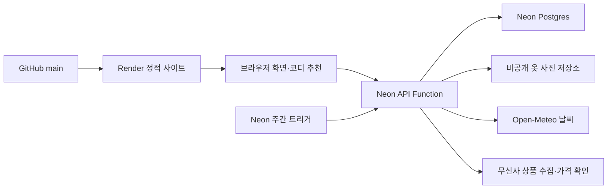

# OOOOTD 코드와 운영 배포 구조

기준일은 2026년 11월 18일이다. OOOOTD는 정적 웹사이트와 별도로 배포하는 API로 구성된다. 브라우저가 코디를 조합하고, Neon API가 공개 상품과 개인 옷장을 제공한다. 화면만 바뀌면 Render에 반영하고, 저장이나 수집 규칙이 바뀌면 Neon Function도 별도로 배포한다.

- 운영 화면 [OOOOTD](https://ooootd.onrender.com)
- 소스 저장소 [pearl-jinju/OOOOTD](https://github.com/pearl-jinju/OOOOTD)
- 리포트 작성 전 마지막으로 확인한 Render 운영 커밋은 `a49c98a`다. 레이스 니트의 성별 보정은 이 리포트와 함께 로컬에서 검증한 변경이다.

## 1. 전체 흐름



PC와 모바일은 동일한 HTML과 추천 규칙을 사용한다. 화면 크기에 따른 배치는 CSS가 담당한다. 상품 사진 자동 분석은 브라우저에서 실행되고, 등록 버튼을 눌렀을 때 옷 사진과 정보가 개인 옷장 API로 전송된다.

## 2. 작업 위치

| 바꾸려는 것 | 먼저 볼 파일 | 변경이 적용되는 곳 |
|---|---|---|
| 홈페이지, 룩북, 다이얼, 추천 버튼 | [index.html](index.html), [home.css](assets/home.css), [lookbook-workspace.css](assets/lookbook-workspace.css) | Render |
| 조합 생성과 순위, 다음·유사 코디 | [index.html](index.html)의 `recalculateRankedCombos`, `buildSimilarVariants`, `renderComboAtCurrentRank` | Render |
| 성별, 격식, 용도, 날씨와 아우터 | [outfits.mjs](shared/outfits.mjs)의 `genderCompatible`, `appropriate`, `outerwearPolicy` | Render의 추천과 Neon의 카탈로그 분류 |
| 상품명에서 핏·색조·소재 태그 추출 | [product-tags.mjs](shared/product-tags.mjs) | Render의 유사도와 Neon의 카탈로그 |
| 사진 분석과 옷장 등록 화면 | [photo-analysis.mjs](frontend/photo-analysis.mjs), [cloud.mjs](frontend/cloud.mjs), [colors.mjs](shared/colors.mjs) | Render. 저장 가능한 값이 바뀌면 Neon API도 반영 |
| 개인 옷장, 프로필, 공개 카탈로그, 가격 API | [app.mjs](backend/app.mjs), [index.mjs](backend/index.mjs) | Neon Function |
| 주간 상품 수집·갱신 | [catalog.mjs](backend/catalog.mjs), [neon.ts](neon.ts) | Neon Function과 트리거 |
| DB 테이블과 권한 | [001_initial.sql](db/001_initial.sql), [backend-config.json](backend-config.json) | Neon Postgres |
| 빌드와 검증 | [build.mjs](scripts/build.mjs), [tests](tests/) | 로컬과 개발 환경 |

루트의 `generate_page.py`와 `update_gender.py`는 과거 실험 스크립트다. 둘 다 실행하면 `index.html`을 덮어쓴다. 운영 페이지 변경은 `index.html`과 현재 프런트엔드 소스에서 한다.

## 3. 코디가 만들어지는 과정

1. 브라우저가 오늘 또는 내일 날씨, 개인 옷장, 공개 카탈로그를 API에서 읽는다. 내일 추천은 최저·최고 기온의 평균을 기온 기준으로 사용한다.
2. 선택한 성별, 코디 용도, 날씨에 맞는 품목을 각각 추린다. 일상과 격식은 겉옷 필요 여부를 다르게 판단한다.
3. 내 옷으로 충분하면 내 옷을 사용한다. 필수 부위가 부족하면 그 부위만 공개 상품으로 보완한다. 사용자가 추천의상 모드를 선택하면 공개 상품으로 조합한다.
4. 기온 적합도, 용도 적합도, 색 조합을 점수에 반영한다. 다음·유사 코디에서 색, 핏, 패턴과 소재 태그를 활용해 연속으로 비슷한 조합이 나오는 것을 줄인다.
5. 룩북은 실제 들어간 품목만 보여준다. 상품 상세를 펼치면 미보유 품목의 가격을 확인하고, 구매 합계는 미보유 품목만 더한다.

## 4. 데이터와 정기 수집

| 데이터 | 저장 위치와 역할 |
|---|---|
| 공개 상품 | Postgres의 `catalog_items`에 상품 ID, 이름, 판매처 성별, 가격, 이미지 URL과 태그를 저장 |
| 내 옷과 신체 정보 | `user_closet`, `user_profiles`에 브라우저 세션의 사용자 ID로 연결. 서버와 DB의 행 단위 접근 정책으로 분리 |
| 개인 옷 사진 | Neon 비공개 버킷에 저장. 소유 확인을 거친 요청에 단기 서명 URL 반환 |
| 브라우저 옷장 연결 | `device_sessions`, `device_claims` 관리. 기기 이동은 일회용 링크로 처리 |
| 주간 실행 기록 | `agent_runs`에 갱신 성공 여부와 카탈로그 수집 결과 기록 |

매주 **월요일 오전 9시 한국시간**에 Neon 트리거가 `POST /cron/catalog`를 호출한다. 수집기는 상품 페이지의 분류와 최신·인기 목록을 읽고, 상품 ID 기준으로 저장한다. 수집량과 용도별 후보 수 검사를 통과한 배치를 적용한다. 검증 실패 시 이전 성공 카탈로그가 유지된다.

## 5. 코드에서 운영 배포까지

로컬은 Node.js 24를 사용한다.

```sh
npm ci
npm run build
npm test
node tests/integration.mjs .build/dev-config.json
node tests/browser.mjs
```

마지막 두 명령은 개발 Neon API 주소를 담은 로컬 `.build/dev-config.json`이 필요하다. 브라우저 테스트는 현재 저장소에 지정된 Edge 실행 경로를 사용한다.

1. **빌드** — [build.mjs](scripts/build.mjs)가 브라우저용 `assets/cloud.js`, HTML이 참조하는 공유 룰 번들, Neon용 `.build/index.mjs`를 만든다. 번들 이름을 바꾼 릴리스는 운영 HTML과 테스트가 새 이름을 참조해야 한다.
2. **개발 검증** — 추천은 단위 테스트에서 확인한다. API 변경은 개발 Neon 브랜치에 배포한 다음 별개 사용자의 옷장 접근, 업로드와 데이터 보존을 검사한다. 화면 변경은 PC·모바일 브라우저에서 확인한다.
3. **프런트엔드 배포** — 배포할 커밋을 GitHub `main`에 푸시하면 연결된 Render 정적 사이트가 자동 배포된다. Render의 `live` 커밋과 운영 URL이 반환하는 HTML·CSS·JS를 함께 확인한다.
4. **백엔드 배포** — 신규 API 번들의 `index.mjs`를 ZIP으로 묶어 기존 Neon `api` Function의 개발 브랜치에 먼저 적용한다. 검증 후 [backend-config.json](backend-config.json)의 운영 브랜치에 배포하고 활성 버전과 실제 응답을 확인한다. GitHub 푸시와 별도로 진행한다.
5. **화면과 API를 함께 바꿀 때** — 새 화면이 새로운 저장 규칙을 필요로 하면 API를 먼저 활성화하고 Render를 배포한다. CDN에서 이전 정적 파일이 남을 수 있으므로, 즉시 반영이 필요한 새 파일은 고유한 파일명으로 참조하고 운영 응답을 확인한다.

공개 주소는 [cloud-config.json](cloud-config.json)에 있다. DB 연결값은 Neon Function의 `OOOOTD_DATABASE_URL`에 보관한다.

## 6. 실제 오류를 추적한 예

남성 코디에 나온 상의는 무신사 상품 ID `7730672`였다. 원본 카탈로그에는 공용으로 기록돼 있었고, 추천 함수가 공용 상품을 남성과 여성 모두의 후보에 넣었다. 제품 사진으로 상품을 대조한 뒤 이 ID의 추천 대상을 여성으로 보정했다. 판매처가 성별을 명시했는데 공용 플래그가 붙은 경우에도 명시된 분류를 우선하도록 했다. 같은 문제가 다시 나오면 **상품 ID와 판매처 분류 → 공개 카탈로그 응답 → 공유 성별 필터 → 실제 추천 화면** 순서로 확인한다. [상품 원본](https://www.musinsa.com/products/7730672)
